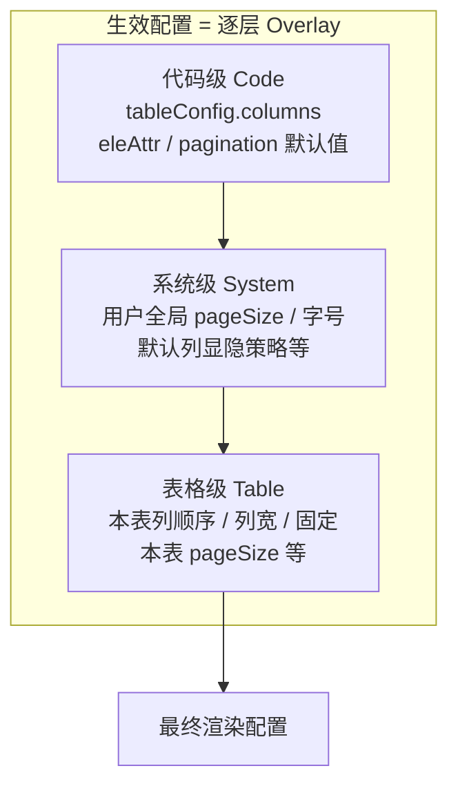

# 表格用户级偏好记忆：一套前端配置 Overlay 架构实践

## 背景

在企业级后台里，表格几乎是最高频的交互载体。用户往往会反复调整：

- 哪些列显示、列顺序如何排布
- 列宽、左右固定列
- 边框/斑马纹等展示样式
- 每页展示条数
- 表格字号

如果每次进入页面都回到代码默认值，体验会很差。更理想的做法是：**代码维护「列的能力与默认定义」，用户偏好作为一层 Overlay 持久化**，两者分离、可合并、可失效。

本文梳理一套在 Vue 2 + Element UI 表格封装中落地的用户级偏好记忆方案（已脱敏，不涉及具体业务域与内部 API 名称）。

---

## 设计目标

| 目标 | 说明 |
|------|------|
| 配置与偏好分离 | 列定义来自业务代码；显隐、顺序、列宽等来自用户 |
| 按用户隔离 | 不同账号互不影响 |
| 按页面/表格实例隔离 | 同一路由下多表互不串数据 |
| 发版可演进 | 列增删改后，旧偏好不能 silently 污染新页面 |
| 跨会话可用 | 刷新、重进页面仍生效；必要时可跨设备同步 |

非目标（当前方案**不**记忆）：

- 当前页码
- 表头点击排序、多条件排序
- 行选中状态

这些属于**会话态**，由业务层自行管理更合适。

---

## 整体架构

系统采用四层结构：

```
┌─────────────────────────────────────────────────────────┐
│  业务表格封装层（Table Wrapper）                          │
│  - 列配置源 tableConfig.columns                          │
│  - 数据请求 / 分页 / 排序（运行时）                        │
└───────────────────────────┬─────────────────────────────┘
                            │
┌───────────────────────────▼─────────────────────────────┐
│  UI 封装层                                               │
│  TableHeader → ColumnSettingsPopover                     │
│  EditableTable → 列渲染 + 表头拖拽                        │
│  Pagination → 分页控件                                   │
└───────────────────────────┬─────────────────────────────┘
                            │
┌───────────────────────────▼─────────────────────────────┐
│  偏好记忆层                                              │
│  - 列设置读写 / merge / 失效                             │
│  - pageSize 本地记忆                                     │
│  - 全局字号（Vuex + 持久化）                             │
└───────────────────────────┬─────────────────────────────┘
                            │
┌───────────────────────────▼─────────────────────────────┐
│  存储层（双通道）                                        │
│  Remote UserPrefs API  ←→  Browser IndexedDB             │
└─────────────────────────────────────────────────────────┘
```

**核心思路**：业务表格本身不直接操作存储；偏好读写集中在「列设置」与「分页」两个基础组件中，通过 props 开关控制行为。

### 组件映射（本项目）

| 抽象层 | 项目组件 |
|--------|----------|
| Table Wrapper | `formEngine/table.vue` |
| TableHeader | `el-table-header-me` |
| ColumnSettingsPopover | `el-show-column-me` |
| EditableTable | `elx-editable-me` |
| Pagination | `el-pagination-me` |

---

## 记忆项与存储策略

### 1. 列级偏好（核心）

**入口**：表格右上角「表格设置」弹层。

**记忆内容**：

| 字段域 | 示例 |
|--------|------|
| 显隐 | `show: true/false` |
| 顺序 | 数组顺序 / 拖拽结果 |
| 列宽 | 表头拖拽后的 `width` |
| 固定 | 左/右固定列数量与 `fixed` |
| 样式 | `border`、`stripe` |
| Slot 列 | selection、index 等特殊列的扩展配置 |

**持久化 payload 结构**（脱敏示例）：

```json
{
  "settingType": "tableColumn_a1b2c3d4e5f6",
  "settingContent": {
    "customTableColumn": [
      { "prop": "code", "label": "编号", "show": true, "width": "120px" },
      { "prop": "name", "label": "名称", "show": true },
      { "prop": "actions", "label": "操作", "show": true, "required": true }
    ],
    "defaultTableColumn": [
      { "prop": "code", "label": "编号", "show": true },
      { "prop": "name", "label": "名称", "show": true },
      { "prop": "actions", "label": "操作", "show": true }
    ],
    "tableStyle": ["border", "stripe"],
    "slotsColumn": []
  }
}
```

- `customTableColumn`：用户生效配置
- `defaultTableColumn`：保存时的代码列快照，用于**失效检测**
- `tableStyle`：表格展示样式勾选
- `slotsColumn`：非 props 驱动的 slot 列配置

**写入时机**：

- 关闭设置弹层时批量提交
- 列拖拽结束、表头拖拽改宽时即时提交
- 500ms 防抖，避免频繁写存储

**双写策略**：

- **Remote**：用户偏好服务（按 `settingType` 读写 `$common.db`），支持跨设备
- **IndexedDB**：本地兜底（`$common.indexDb`），离线或接口失败时仍可恢复

读取默认走 Remote；写入时 Remote + IndexedDB 各存一份。

---

### 2. 分页条数（pageSize）

**范围**：仅记忆 `pageSize`，不记忆当前页码。

**Key 生成**：

```
tid = md5(routePath + paginationDomInstanceId).slice(2, 18)
storageKey = "pagination" + tid
```

**存储**：仅 IndexedDB（更轻、页面级即可）。

**例外**：若业务层在 `paginationConfig.eleAttr` 中**显式写死** `pageSize`，则设置 `ignoreIndexDb: true`，既不读取也不保存——代码默认值优先于用户记忆。

`formEngine/table.vue` 中的处理：

```javascript
paginationEleAttr() {
  const eleAttr = { ...(this.paginationConfig || {}).eleAttr || {} };
  if (eleAttr.pageSize != null) {
    eleAttr.ignoreIndexDb = true;
  }
  return eleAttr;
}
```

---

### 3. 表格字号（全局）

字号属于**全局偏好**，不跟单表走：

- 写入 Vuex（`setTableFontSize`）
- 同步持久化到 Remote + IndexedDB（key: `tableFontSize`）
- 通过 `document.documentElement` 的 `scale-size` 属性全局生效

在「表格设置」里修改字号，影响所有表格的视觉密度。

---

## 缓存 Key 与隔离维度

列偏好 Key：

```
columnSignature = sort(prop + label).join("")
tid = md5(routeKey + optionalTableTag + columnSignature + userId).slice(2, 18)
storageKey = "tableColumn" + tid
```

| 维度 | 作用 |
|------|------|
| `routeKey` | 默认 `$route.path`；同页多表可传 `showColumnKey` 覆盖 |
| `userId` | 用户隔离 |
| `columnSignature` | 列集合变化 → 新 Key，旧缓存自然 miss |
| `optionalTableTag` | 同路由多实例进一步区分（`tagId`） |

分页 Key 独立生成，与列 Key 解耦。

---

## 数据流

### 加载（Read Path）

```
业务 columns 传入
    ↓
table.vue watch → tableHeaderConfig（代码默认）
    ↓
el-show-column-me mounted / init
    ↓
$common.db.loadObject("tableColumn" + tid)
    ↓
┌─ 无缓存 ─────────────────→ 使用 tableConfig.columns
│
└─ 有缓存
      ↓
   isTableConfigUpdated?  （default 快照 vs 当前 defaultColumnConfig）
      ↓
   ┌─ true  ──→ 整包丢弃，回代码默认
   └─ false ──→ 按 prop merge customTableColumn
                  补回函数型属性（JSON 存不下的回调）
      ↓
setModelValue → 更新 tableHeaderConfig → 表格重渲染
```

### 保存（Write Path）

```
用户改显隐 / 拖拽 / 固定 / 样式 / 列宽
    ↓
组装 { customTableColumn, defaultTableColumn, tableStyle, slotsColumn }
    ↓
saveTableColumn debounce 500ms
    ↓
$common.db.saveObject + $common.indexDb.saveObject
```

### 列宽的特殊路径

表头拖拽不直接在表格层写存储，而是通过**事件总线**通知列设置组件统一落库：

```
elx-editable-me  @header-dragend
    → $bus.$emit("tableMeBus", "headerDragEnd", column)
    → el-show-column-me 更新 tableColumn.width
    → handleSubmit → saveTableColumn
```

---

## 失效策略：`isTableConfigUpdated` 的取舍

当前实现：

```javascript
isTableConfigUpdated(res) {
  const config = JSON.stringify(res.defaultTableColumn);
  const currentConfig = JSON.stringify(this.defaultColumnConfig);
  return config !== currentConfig;
}
```

**意图**：代码侧列定义变了，就丢弃用户缓存，防止脏数据。

**优点**：实现简单，能覆盖 width、eleAttr、required 等默认值变更。

**局限**：

| 问题 | 影响 |
|------|------|
| 整包 JSON 比较 | 改一个列的默认 width，所有列的用户偏好一起重置 |
| 函数不参与序列化 | 回调逻辑变更检测不到，可能继续用旧缓存 |
| `defaultColumnConfig` 来源不稳定 | `init` 与 `getFixedNum` 推导 fixed 后可能不一致，误杀或漏杀 |
| 与 `columnSignature` 职责重叠 | 增删列靠 tid 已隔离；该函数主要管「同 Key 下定义漂移」 |
| 无增量 merge | 新增列时不能「保留旧列偏好 + 新列走默认」 |
| `slotsColumn` 未参与判断 | slot 列结构变更可能仍走旧缓存 |

**演进方向**：

1. 用 **`columnSignature`（prop+label 集合）** 做结构级失效
2. 结构不变时，**按 prop 增量 merge** 用户偏好
3. 代码语义字段（`required`、`minWidth` 等）单独 diff，只覆盖对应列
4. 显式 **`schemaVersion`**，发版大改时一键清空
5. 失效后主动 rewrite / delete 远端记录，避免 DB 留脏 Key

---

## 业务侧配置开关

| 需求 | 配置 |
|------|------|
| 关闭列记忆 | `el-table-header-me` 传 `:canSaveColumn="false"` |
| 同页多表 | `:showColumnKey="'uniqueId'"` |
| 开启列拖拽排序 | `:showColumnDrag="true"`（`table.vue` 已默认 true） |
| 禁用 pageSize 记忆 | `paginationConfig.eleAttr.pageSize` 写死，或 `ignoreIndexDb: true` |
| 关闭旧版列宽方案 | 不传 `saveWidth`（新方案走设置弹层 + bus） |

优先级约定（**当前实现**）：业务显式写死的 `pageSize` / `ignoreIndexDb` 等 **强制代码级锁定**，高于用户记忆。

目标态见 [改进方向](#改进方向)：**表格级 > 系统级 > 代码级**，代码级通过 `preferencePolicy` 声明不可被覆盖的字段。

---

## 与 formEngine/table.vue 的边界

**table.vue 负责**：

- 接收 `tableConfig.columns` 作为列定义源
- 维护 `tableHeaderConfig` 并与 `el-table-header-me` 双向同步
- 组装接口请求（分页、排序参数）
- 控制是否初始拉数、是否展示 selection/index

**table.vue 不负责**：

- 直接读写 Remote / IndexedDB
- 列偏好 merge 逻辑

任意业务页使用 `formEngine/table.vue`，默认获得用户偏好能力；关闭只需一个 prop。

---

## 运行时态 vs 持久态

| 持久态（跨会话） | 运行时态（当前页） |
|------------------|-------------------|
| 列显隐/顺序/宽/固定 | 当前页 `page` |
| 表格 border/stripe | `sortOrderList` |
| `pageSize` | 选中行 `selectedRowIds` |
| 全局 `tableFontSize` | 表格 rows 数据 |

查询条件（`formData`）变化时，`table.vue` 将 `page` 重置为 1——搜索语义变了，不应继承旧页码。

---

## 实践建议

### 对组件维护者

1. 列定义变更时，优先改 `prop`/`label` 或升 `schemaVersion`，不要 silent 改语义
2. 保存 `defaultTableColumn` 时用**规范化快照**（剔除 `show`、函数、运行时字段）
3. 失效后主动 rewrite 或 delete 远端记录
4. 显隐尽量统一用 `prop` 标识；若 UI 层用 `label`，rename label 要有迁移策略

### 对业务接入者

1. 同页多表务必传 `showColumnKey`
2. 需要固定 pageSize 的报表页，显式写死并开启 `ignoreIndexDb`
3. 列上不要放不可序列化的复杂对象进 default 快照
4. 发版说明里标注「列结构变更」vs「仅样式默认值变更」，方便评估用户偏好是否会被重置

---

## 改进方向

### 现状：偏好层级扁平

当前实现里，用户偏好大体落在两个粒度：

| 粒度 | 覆盖范围 | 典型 Key | 说明 |
|------|----------|----------|------|
| 表格级 | 单表列设置、pageSize | `tableColumn${tid}`、`pagination${tid}` | 按路由 + 列签名 + 用户隔离 |
| 准全局 | 表格字号 | `tableFontSize` | 已具备「跨表生效」，但未与表格级、代码级形成统一优先级模型 |

其余能力（列定义、是否允许记忆、`ignoreIndexDb` 等）散落在**代码配置**中，三者之间缺少明确的 **merge 规则** 与 **存储分层**。结果是：

- 用户在某张表上的设置，无法继承「系统默认偏好」再局部覆盖
- 管理员配置的「推荐列布局」与「用户个性化」边界不清
- 代码强制项（如 `required` 列不可隐藏）与用户记忆的冲突处理分散在各处

---

### 目标：三层偏好模型

将表格相关配置拆为三层，按优先级自高向低合并：

```
表格级（Table）  >  系统级（System）  >  代码级（Code）
   用户对本表的个性化       用户/租户全局默认          业务代码声明的基准
```



**优先级规则**（高者覆盖低者，低者仅填充「未设置」字段）：

| 优先级 | 层级 | 来源 | 典型内容 | 存储 Key 示例 |
|--------|------|------|----------|---------------|
| 低 | **代码级** | `tableConfig` / 业务页面 | 列定义、默认显隐、`required`、默认 `pageSize`、是否开启记忆 | 无（源码） |
| 中 | **系统级** | 用户偏好服务 / IndexedDB | 默认 `pageSize`、全局字号、默认表格样式（border/stripe）、「新表默认隐藏某类列」等 | `systemTablePrefs_${userId}` |
| 高 | **表格级** | 用户偏好服务 / IndexedDB | 本表列显隐/顺序/列宽/固定、本表 `pageSize`、本表样式 | `tableColumn${tid}`、`pagination${tid}` |

**合并示例**：

```
代码级：pageSize = 10，列 A/B/C 均 show: true
系统级：pageSize = 20，tableFontSize = 1.1
表格级：隐藏列 B，列 A 宽 200px

最终生效：
  pageSize = 20（表格级未覆盖 pageSize → 继承系统级）
  列 A show + width 200px（表格级）
  列 B hidden（表格级）
  列 C show（表格级未设置 → 系统级无 → 代码级）
  字号 1.1（系统级，表格级通常不重复存）
```

**代码级强制项**（不参与被覆盖，始终生效）：

- `required: true` 的列不可被系统级/表格级隐藏
- `canSaveColumn: false`、`ignoreIndexDb: true` 等开关——表示该字段**不允许**上层偏好写入
- 列结构变更（`columnSignature` 变化）——表格级缓存失效，回退到 **系统级 + 代码级** 合并结果，而非直接裸代码默认

---

### 各层职责划分

#### 1. 代码级（Code）

- **定位**：业务真相源（Source of Truth for schema）
- **职责**：声明「有哪些列、默认怎么展示、哪些能力开放给用户改」
- **不参与持久化**，发版随代码变更
- **示例**：

```javascript
tableConfig: {
  columns: [{ prop: 'name', label: '名称', show: true, required: false }],
  preferencePolicy: {
    allowColumnMemory: true,   // 是否允许表格级列记忆
    allowPageSizeMemory: true, // 是否允许 pageSize 记忆
    lockColumns: ['actions'],  // 强制展示、不可隐藏
  },
  paginationConfig: { eleAttr: { pageSize: 10 } },
}
```

#### 2. 系统级（System）

- **定位**：用户跨所有表格的「习惯默认值」
- **职责**：减少每张表都要重新设置的成本；新表首次打开即有合理默认
- **存储**：按 `userId`（可选 `tenantId`）一条或分 domain 多条
- **示例字段**：

```json
{
  "pageSize": 20,
  "tableFontSize": 1.0,
  "defaultTableStyle": ["stripe"],
  "defaultHiddenColumnTypes": []
}
```

- **与现有实现对齐**：`tableFontSize` 已是系统级雏形；`pageSize` 若从「仅表格级 IndexedDB」上提，可成为系统级默认，表格级再 optional 覆盖

#### 3. 表格级（Table）

- **定位**：用户对**某一具体表格实例**的个性化（当前 `tableColumn${tid}` 的主体能力）
- **职责**：列显隐、顺序、列宽、固定、本表样式、本表 pageSize（若与系统默认不同）
- **存储**：保持现有 `tid` 隔离（路由 × 列签名 × 用户 × `showColumnKey`）
- **只存 diff**：相对「系统级 + 代码级」合并结果的差异，减小 payload、便于 merge

---

### 加载链路（目标态）

```
1. 读取代码级 tableConfig.columns + preferencePolicy
2. 读取系统级 systemTablePrefs（userId）
3. merge → baseConfig
4. 读取表格级 tableColumn${tid} / pagination${tid}
5. 校验 columnSignature / schemaVersion
6. 按 prop 增量 merge 表格级 diff → finalConfig
7. 应用代码级 lock / required 等强制约束
8. 渲染
```

---

### 与当前实现的迁移路径

| 阶段 | 动作 |
|------|------|
| P0 | 文档化三层模型；`tableFontSize` 明确标注为系统级 |
| P1 | 抽象 `resolveTablePreference(code, system, table)` merge 函数，替换散落的直接赋值 |
| P2 | `pageSize`：表格级未设置时 fallback 系统级；显式 `ignoreIndexDb` 仍表示「锁定代码级」 |
| P3 | 表格级 payload 改为存 diff；`isTableConfigUpdated` 改为 signature + 按列 merge |
| P4 | 可选：租户级系统默认（管理员下发）介于代码级与用户系统级之间 |

---

### 小结（三层模型）

> **代码级定能力边界 → 系统级定用户习惯默认 → 表格级定单表个性化**

优先级 **表格级 > 系统级 > 代码级**，既保留发版可控性，又避免「每张表从零配置」，同时为已有的 `tableFontSize`、未来的全局 `pageSize` 默认值提供统一落点。

---

## 参考样例

本地可参考 `tableData.js`：其中 `settingType` / `settingContent` 结构与 Remote 用户偏好接口返回一致，可用于联调与文档对照。

---

## 小结

这套表格用户级偏好记忆，本质上是：

> **代码列配置（Source of Truth） + 用户 Overlay（customTableColumn） + 双通道存储（Remote + IndexedDB） + Key 隔离（路由 × 用户 × 列签名）**

它解决了后台表格最高频的个性化诉求，也在「发版演进」与「用户体验」之间做了 pragmatic 权衡。当前的全量 JSON 失效检测能工作，但偏粗糙；若产品对「改一个默认列宽就丢全部设置」敏感，下一步应演进为 **签名级失效 + 按列增量 merge**，并引入 **系统级 / 表格级 / 代码级** 三层偏好模型统一 merge 与存储。

---

*本文基于 Vue 2 表格封装组件现有实现整理，示例数据与存储 Key 均已脱敏。*
